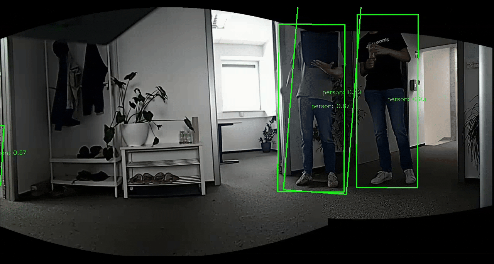
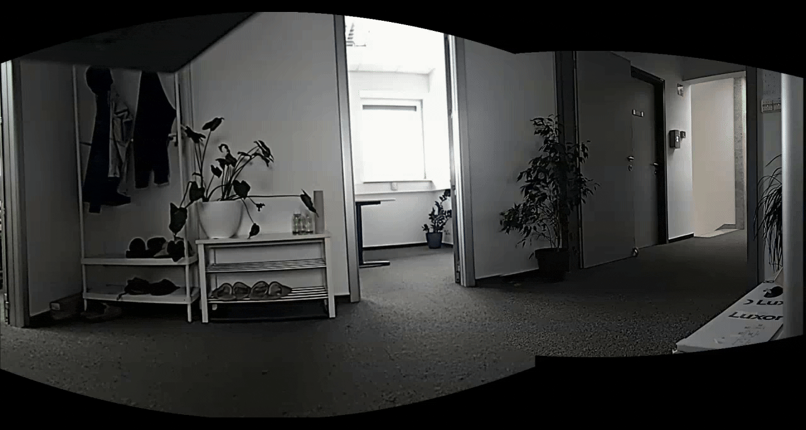

# Image filter detections

Run object detection on two stereo cameras or multiple OAK devices, then use
`dai.node.ImgDetectionsFilter` to map their detections into a calibrated panorama.
Compare all detections with the filtered result in the DepthAI Visualizer.

The filter demonstrates label selection/rejection, confidence and box-area
thresholds, a detection limit, and duplicate handling between cameras. `NMS`
keeps one box from overlapping detections of the same class; `AVERAGE` combines
their boxes using confidence weights. `OFF` preserves duplicates.

**Turning filtering on and off:**



**A person walking with filtering enabled:**



## Setup

This is a host-only example for RVC2 and RVC4. The default stereo mode requires
calibrated `CAM_B` and `CAM_C` cameras. Multi-device mode requires at least two
devices with `CAM_A`, overlapping views, and a cross-device calibration graph.

`requirements.txt` pins the development build
`depthai==3.10.0.dev0+3e3471137d99c00fc0ce18a3105f8b1854258845`.
It also adds the Luxonis snapshot package index, where development wheels are
published, so the install command below searches that index alongside PyPI.

Run these commands from this example directory:

```bash
python3.12 -m venv .venv
source .venv/bin/activate
python -m pip install -r requirements.txt
python -c "import depthai; print(depthai.__file__); print(depthai.__version__)"
```

The import should resolve to the installed package in your virtual environment
and report `3.10.0.dev0+3e3471137d99c00fc0ce18a3105f8b1854258845`.
If you previously added the local `depthai-core` build directory to `PYTHONPATH`,
remove that entry so Python imports the installed package.

## Stereo device

```bash
python main.py
# Select a particular stereo device:
python main.py --device DEVICE_ID_OR_IP
# Keep confident people with boxes of at least 500 panorama pixels squared:
python main.py --labels 0 --confidence 0.6 --min-area 500 --max-detections 10
```

Both stereo cameras run the same detector. Their factory calibration supplies
the common coordinate system; this example uses the stereo camera pair without
computing depth.

## Multiple devices

Generate a graph JSON with the `MultiDeviceCalibration` example in your
`depthai-core` checkout, using the installed build. Point the devices at a shared
textured scene, keep them still, and run:

```bash
python /home/aljazd/Documents/depthai-core/examples/python/MultiDeviceCalibration/multi_device_calibration.py \
    --devices DEVICE_A DEVICE_B --output calibration.json
python main.py --devices DEVICE_A DEVICE_B --calibration calibration.json
```

Use the same devices and physical arrangement for calibration and inference.
This graph JSON is different from the `.npz` extrinsics produced by this repo's
`multi-cam-calibration` tutorial. The model is resolved separately for each
device platform; all detectors must use the same class IDs.

## Visualizer and controls

Open `http://localhost:8082`. Each camera group shows its inference frame and
source detections. The **Before filtering** and **After filtering** groups show
the same panorama with all source-visible detections and filtered detections,
respectively. Select the image and detection topics in each group to compare
the overlays. Focus the Visualizer before using the keyboard controls.

| Key              | Action                                            |
| ---------------- | ------------------------------------------------- |
| `1` / `2` / `3`  | Set duplicate handling to OFF / NMS / AVERAGE     |
| `W` / `S`        | Increase / decrease overlap IoU threshold by 0.05 |
| `+` or `=` / `-` | Increase / decrease confidence threshold by 0.05  |
| `Q`              | Quit                                              |

Current thresholds are printed to the terminal. Each change sends a fresh,
complete config, preserving the label, area, and detection-limit settings.

Additional options:

- `--reject-labels 0`: reject people; rejection takes precedence over `--labels`.
- `--overlap average --iou 0.3`: choose initial duplicate handling.
- `--no-source-masks`: disable the default visibility masks to inspect detections
  from all cameras, including objects hidden by the panorama's seam composition.
- `--projection Perspective`: change the default cylindrical projection.
- `--no-blend`: disable exposure compensation and multiband blending for lower
  host CPU usage.
- `--fps 5`: reduce inference and transfer load.
- `--sync-threshold-ms 50`: control timestamp matching tolerance.

Run `python main.py --help` for all options.

## Limitations

- Panorama remapping uses camera intrinsics and rotation, without depth or
  camera translation. Nearby objects can retain parallax errors; use distant
  scenes to assess duplicate merging. Full 360-degree seam-crossing boxes are
  unsupported.
- Timestamp matching selects nearby captures; it does not synchronize camera
  exposure. Its tolerance must be positive and no larger than one frame period.
- Detectors emit boxes at confidence 0.1 or higher. Filtering cannot recover
  boxes rejected by the detector. Area thresholds use the output panorama's
  pixels, so changing projection can change which boxes pass.
- Source masks are enabled for both panorama views. They remove fully hidden
  source boxes even in OFF mode and favor the camera whose pixels are visible
  when choosing or averaging duplicates. With `--no-source-masks`, parallax can
  offset a hidden camera's box from the object rendered by another camera.
  Direct composition (`--no-blend`) gives later cameras precedence in overlap.
- Stitching and multi-input filtering run on the host. This example has no
  standalone packaging path.
